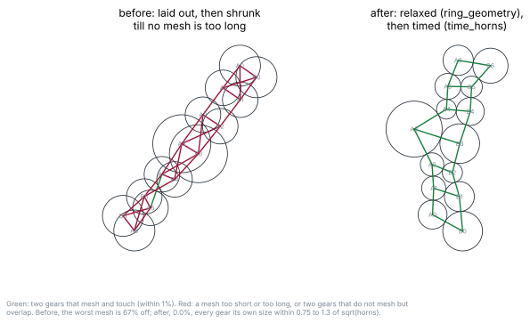
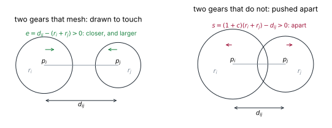
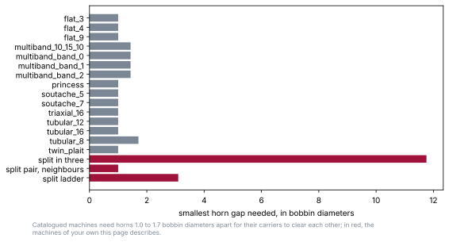

# Laying out a horn gear machine

A horn gear machine is written as the gears that mesh
({mod}`braidpy.horn_gear.described`). Which slots meet is all the simulation
needs, but everything drawn and laid from it — where each carrier is, the
yarns it lays, the braid word read from them — comes from where the gears
stand and how large they are. This page says how braidpy places them in a
machine whose gears make rings, as a matrix of gears does, when each contact
hands over, and how large a machine must be for its bobbins.

## Gears that mesh touch, no others overlap

Gear $i$ stands at $p_i$ and is drawn with radius $r_i$, by convention
$\sqrt{h_i}$ for $h_i$ horns ({func}`~braidpy.horn_gear.layout.gear_radii`),
a convention for drawing and not a constraint of the machine. Two gears that
mesh should just touch, and two that do not should stay clear of each other:

$$
\lVert p_i - p_j \rVert = r_i + r_j \quad \text{for } i, j \text{ meshing},
\qquad
\lVert p_i - p_j \rVert \ge (1 + c)\,(r_i + r_j) \quad \text{otherwise},
$$

with $c$ = `CLEARANCE` = 0.1, room for the carriers going by.

A chain or a tree of gears is placed gear by gear, each mesh exact. A single
ring of gears alike, as a tubular braider is, is a regular polygon, also
exact. A ring of gears of several sizes, or rings sharing gears, can rarely be
both. The graph used to be laid out with a spring layout (Kamada–Kawai where
SciPy is installed) aiming each mesh at $r_i + r_j$, then shrunk until no mesh
was *longer* than that. Every other mesh then came out *shorter*: gears ran
through each other.

## Relaxing the layout

{func}`~braidpy.horn_gear.layout.ring_geometry` starts from that layout,
unshrunk, and relaxes it a round at a time.

For each pair of meshing gears, the error and the unit vector between them are

$$
e_{ij} = \lVert p_j - p_i \rVert - (r_i + r_j),
\qquad
u_{ij} = \frac{p_j - p_i}{\lVert p_j - p_i \rVert},
$$

A share $1 - \gamma$ of the error moves the centres, half each, and $\gamma$
(`RADIUS_GIVE` = 0.2) grows or shrinks the radii:

$$
\Delta p_i = +\tfrac{1 - \gamma}{2}\, e_{ij}\, u_{ij}, \qquad
\Delta p_j = -\tfrac{1 - \gamma}{2}\, e_{ij}\, u_{ij}, \qquad
\Delta r_i = \Delta r_j = \frac{\gamma\, e_{ij}}{2}.
$$

For each pair that does not mesh but is too close,

$$
s_{ij} = (1 + c)(r_i + r_j) - \lVert p_j - p_i \rVert > 0
\quad\Rightarrow\quad
\Delta p_i = -\tfrac{s_{ij}}{2}\, u_{ij}, \quad \Delta p_j = +\tfrac{s_{ij}}{2}\, u_{ij}.
$$

All pairs are taken at once, each gear moved by the mean of what its pairs
ask. Each radius stays within `RADIUS_RANGE`, 0.75 to 1.3 times its
convention: sizes change only as far as needed for the gears to touch. It
stops when the worst error,
as a share of the length it should be, is under `RELAX_TOLERANCE` (0.1%), or
after `RELAX_ROUNDS`.

A start can fold a ring into a bow-tie, two of its sides crossing, which no
relaxing undoes. So it is relaxed from several starts — the spring layout, a
planar one where the gears can be drawn without crossing, and `SPRING_STARTS`
more spring layouts — and the best is kept. A layout already within the
tolerance is kept as it is, so a tubular braider does not move. It is not an
exact solution, only one with no gear through another.

## Every contact on a horn

A gear turns one slot a step, so a horn of it comes round to each of its
contacts once a step. Where every contact of a gear is a whole number of
slots from the others, as round a ring of four gears, a turning puts a horn
on each at the end of every step, and they all hand over then. Often none
does:

- round a ring of six or eight gears of four slots, a gear's two contacts
  are $180 - 360/N$ = 120 or 135 degrees apart, its horns 90;
- in a matrix of gears, the angles at the corners of a square, each a whole
  number of slots, have to add up to a turn: on the split ladder's squares
  of 3- and 4-slot gears they add up to $90 + 120 + 120 + 90 = 420$ degrees.

So each contact hands over when a horn of each of its two gears comes round
to it, a fraction of a step in
({class}`~braidpy.horn_gear.model.Connection`'s `phase`). Gear $u$, of $n_u$
slots a part, turning $d_u = \pm 1$ and turned $\psi_u$ to start with,
brings its part $p_u$ of $k_u$ to a contact at angle $\alpha_u$ at the times
$t$ with

$$
d_u \left( \frac{(\alpha_u - \psi_u)\, n_u}{2\pi} - \frac{p_u}{k_u} \right)
\equiv t \pmod 1 .
$$

Two gears hand over when their times agree. Written with
$x_u = d_u n_u \psi_u / 2\pi$, a contact between $u$ and $v$, where
$\alpha_v = \alpha_u + \pi$, asks

$$
x_u - x_v \equiv \frac{d_u n_u \alpha_u - d_v n_v \alpha_v}{2\pi}
- \frac{d_u p_u}{k_u} + \frac{d_v p_v}{k_v} \pmod 1 .
$$

There is one $x$ a gear and one equation a contact, so round each ring of
gears one equation is left over, and the layout has to meet it. Round a
single ring of gears alike it cancels: no gear moves.
{func}`~braidpy.horn_gear.horn_timing.time_horns` moves and sizes the gears
from the relaxed layout till every two that mesh touch, no two others come
within `CLEARANCE`, and every contact's two horns arrive at once: a
least-squares fit of all three, by Levenberg–Marquardt with exact
derivatives. A ring whose whole-slot contacts miss their horns by more than
`OFF_HORN` is timed so ({mod}`~braidpy.horn_gear.described`). Its carriers
make the same braid; they are only drawn, and handed over, where the horns
are.

### Two split axles meshing twice

Two split axles of $h$ horns each, parts $a$ and $b$ taking turns round each,
meshing twice (`A1-B1 A2-B2 A1+A2 B1+B2`), touch at one contact, and their
parts' $p_u / k_u$ take them round to it in turn. A step turns
each part one of its slots, two pitches $2\pi/h$ of the axle, the two axles
opposite ways, so a horn of each comes round to the contact every half step,
the parts in turn. A step is then two ticks, a pitch each: the $a$ horns meet
at the contact and hand over at the end of the step, the $b$ horns half a
step on, at the same point
({class}`~braidpy.horn_gear.model.Connection`'s `phase`). The two bands share
the contact, never there at the same time. With $k$ parts a step is $k$
ticks.

## How large a machine must be for its bobbins

The simulation stops a machine where two carriers would take one slot
({class}`~braidpy.horn_gear.simulation.CollisionError`). Two carriers in
different slots can still come close in space. Drawn larger, gear sizes and
places together, a machine keeps every two carriers further apart in
proportion, so any two that do not come to one point clear each other on a
machine large enough for its bobbins.
{func}`~braidpy.horn_gear.take_off.clearance` follows the carriers as they
are drawn and finds the closest two come, $d$. Bobbins of diameter $b$ clear
each other on the machine drawn $b / d$ times as large, where the smallest
gap between two neighbouring horns of a gear,

$$
g = \min_i \, 2\, r_i \sin\frac{\pi}{h_i}
$$

(round a split gear, all its parts' horns count), is $g \, b / d$: $g / d$
bobbin diameters. Braid Studio sizes every machine so for bobbins of
`bobbin_diameter` (20 mm unless the link says otherwise), and says how
large its horns, gears and deck come out.

Two carriers closer than `MEET` of $g$ are at one point, as far as the
samples, `CLOSEST_SUBSTEPS` a step, can tell: they would hit on a machine of
any size, and the machine stops there
({func}`~braidpy.horn_gear.take_off.too_close`). Machines driven by a card,
as lace machines are, swap two bobbins by passing one by the other, and are
not looked at.

A gear split in three meshing with ordinary gears brings a carrier leaving
for a neighbour close by the next part's horn coming round to the same
contact: it has to be large for its bobbins, its horns about twelve bobbin
diameters apart.
