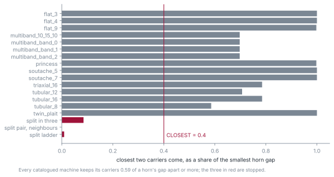
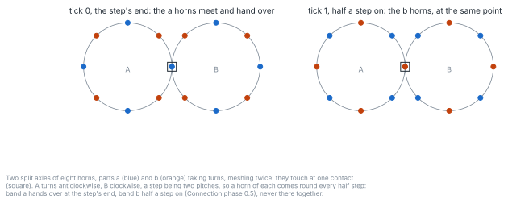

# Laying out a horn gear machine

A horn gear machine is written as the gears that mesh
({mod}`braidpy.horn_gear.described`). Which slots meet is all the simulation
needs, but everything drawn and laid from it — where each carrier is, the
yarns it lays, the braid word read from them — comes from where the gears
stand and how large they are. This page says how braidpy places them in a
machine whose gears make rings, as a matrix of gears does, and when it stops
a machine whose carriers would hit.

## Gears that mesh touch, no others overlap

Gear $i$ stands at $p_i$ and is drawn with radius $r_i$, by convention
$\sqrt{h_i}$ for $h_i$ horns ({func}`~braidpy.horn_gear.layout.gear_radii`),
a convention for drawing and not a constraint of the machine. Two gears that
mesh should just touch, and two that do not should stay clear of each other:

$$
\lVert p_i - p_j \rVert = r_i + r_j \quad \text{for } i, j \text{ meshing},
\qquad
\lVert p_i - p_j \rVert \ge (1 + c)\,(r_i + r_j) \quad \text{otherwise},
$$

with $c$ = `CLEARANCE` = 0.1, room for the carriers going by. Two split axles
sharing two bobbins are the exception: they interpenetrate, their centres
$2 \cos(\pi / h)$ radii apart
({func}`~braidpy.horn_gear.layout.sharing_two_bobbins`), and that is the
distance they are held at.

A chain or a tree of gears is placed gear by gear, each mesh exact. A single
ring of gears alike, as a tubular braider is, is a regular polygon, also
exact. A ring of gears of several sizes, or rings sharing gears, can rarely be
both. The graph used to be laid out with a spring layout (Kamada–Kawai where
SciPy is installed) aiming each mesh at $r_i + r_j$, then shrunk until no mesh
was *longer* than that. Every other mesh then came out *shorter*: gears ran
through each other.

## Relaxing the layout

{func}`~braidpy.horn_gear.layout.ring_geometry` starts from that layout,
unshrunk, and relaxes it a round at a time.

For each pair of meshing gears, the error and the unit vector between them are

$$
e_{ij} = \lVert p_j - p_i \rVert - \rho_{ij}\,(r_i + r_j),
\qquad
u_{ij} = \frac{p_j - p_i}{\lVert p_j - p_i \rVert},
$$

with $\rho_{ij} = 1$, or $\cos(\pi/h)$ for two axles sharing two bobbins. A
share $1 - \gamma$ of the error moves the centres, half each, and $\gamma$
(`RADIUS_GIVE` = 0.2) grows or shrinks the radii:

$$
\Delta p_i = +\tfrac{1 - \gamma}{2}\, e_{ij}\, u_{ij}, \qquad
\Delta p_j = -\tfrac{1 - \gamma}{2}\, e_{ij}\, u_{ij}, \qquad
\Delta r_i = \Delta r_j = \frac{\gamma\, e_{ij}}{2 \rho_{ij}}.
$$

For each pair that does not mesh but is too close,

$$
s_{ij} = (1 + c)(r_i + r_j) - \lVert p_j - p_i \rVert > 0
\quad\Rightarrow\quad
\Delta p_i = -\tfrac{s_{ij}}{2}\, u_{ij}, \quad \Delta p_j = +\tfrac{s_{ij}}{2}\, u_{ij}.
$$

All pairs are taken at once, each gear moved by the mean of what its pairs
ask. Each radius stays within `RADIUS_RANGE`, 0.75 to 1.3 times its
convention: sizes change only as far as needed for the gears to touch. Two
axles sharing two bobbins keep the radii the closed form gives them, or the
bobbins would no longer be whole horns apart. It stops when the worst error,
as a share of the length it should be, is under `RELAX_TOLERANCE` (0.1%), or
after `RELAX_ROUNDS`.

A start can fold a ring into a bow-tie, two of its sides crossing, which no
relaxing undoes. So it is relaxed from several starts — the spring layout, a
planar one where the gears can be drawn without crossing, and `SPRING_STARTS`
more spring layouts — and the best is kept. A layout already within the
tolerance is kept as it is, so a tubular braider does not move. It is not an
exact solution, only one with no gear through another.

## Carriers that would hit

The simulation stops a machine where two carriers would take one slot
({class}`~braidpy.horn_gear.simulation.CollisionError`). Two carriers in
different slots can still meet in space.
{func}`~braidpy.horn_gear.take_off.too_close` follows the carriers as they
are drawn and stops the machine where two come closer than

$$
\text{CLOSEST} \cdot g, \qquad g = \min_i \, 2\, r_i \sin\frac{\pi}{h_i},
$$

$g$ the smallest gap between two neighbouring horns of any gear (round a
split gear, all its parts' horns count) and `CLOSEST` = 0.4, a bobbin being
about half that gap wide. Braid Studio stops the braid there and rings the
two carriers. Machines driven by a card, as lace machines are, swap two
bobbins by passing one by the other, and are not looked at.

### Two split axles sharing two bobbins

Two split axles of $h$ horns each, parts $a$ and $b$ taking turns, share two
bobbins at the two crossings of their circles, $X$ for band $a$ and $Y$ for
band $b$, each half a pitch, $\pi/h$, off the line of centres. A step turns
each part by one of its slots, two pitches of the axle, $4\pi/h$, the two
axles opposite ways. Half a step on, each axle has turned one pitch,
$2\pi/h$: the $b$ horn that was at $Y$, at $-\pi/h$, is at $+\pi/h$, which is
$X$, on both axles at once. Both circles pass through both crossings, so the
other band's horns meet at each bobbin halfway through every step, and two
carriers on them meet.

So such a machine stops wherever both those horns are loaded. The split
ladder does in its first step; so does a gear split in three, more mildly,
where a carrier leaving for a neighbour passes close by the next part's horn
coming round to the same contact.
