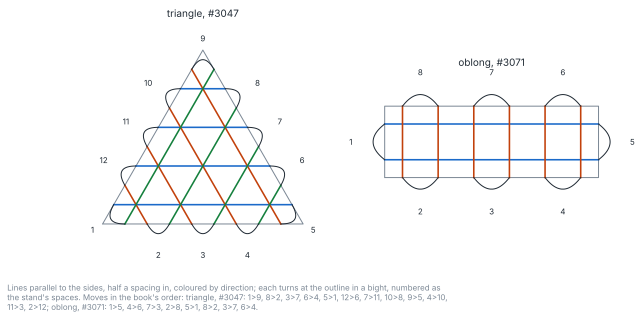
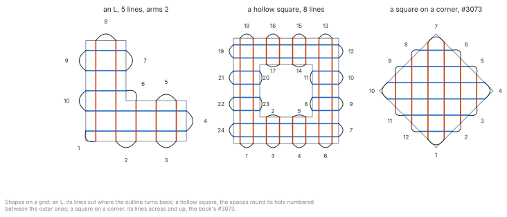

# Making a braid by hand or on a machine

braidpy makes a braid many ways: as a braid word, on a kumihimo disk, on
Ashley's stand, on a braiding machine, on a Jacquard lace machine. Each
already gives the braid it makes, as a braid word. {mod}`braidpy.making`
goes the other way: from a braid — a braid word, say — to how to make it.

Two braids are the same braid, here, when nothing braidpy measures
of their topology tells them apart: their patterns are alike
({func}`~braidpy.braid_pattern.alike`,
see {doc}`comparing_braids`): a way of making a braid need not make its very
word, only the same braid. Each way is checked by reading the braid back
off what it made, with the code that reads it off that way of making
braids, and comparing.

## Neighbours swapping places round a ring

A braid word, a kumihimo disk and a lace machine all make a braid by
moving strands round a ring of places, two neighbours at a time. A
{class}`~braidpy.ring_program.RingProgram` says so once, for all of them:

- the places round the ring, and which strand starts where — a place may be
  empty;
- rows of **swaps**: two neighbouring places exchanging what they hold, the
  swaps of a row sharing no place, so made at once. Two strands swapping
  make a crossing; a strand and an empty place make none, the strand only
  moving on by a place.

The ring is seen from above, from the side the braider works from on a
kumihimo disk, and the braid is made downwards, away from the eye, as it
hangs below a disk. Places are numbered clockwise from 0, the ring's seam
between the last and place 0, and the swap of place `p` exchanges places
`p` and `p + 1`. Its sign is the crossing's, as a braid word writes it:

- **+1**: the strand at `p + 1` goes first, anticlockwise, lifted over the
  one at `p` — over seen from above, so passing inside it, nearer the
  braid's axis — and the strand at `p` moves clockwise into the place it
  left. With the strands at places 1 to n counted from the seam, the
  positive swap of place `i - 1` is σᵢ.
- **−1**: the strand at `p` goes first, clockwise, over the one at `p + 1`:
  σᵢ⁻¹.

A swap with an empty place crosses nothing, and its sign changes nothing.

```python
from braidpy import Braid
from braidpy.ring_program import from_braid

plait = Braid((1, -2) * 3, 3)
program = from_braid(plait, n_places=6)  # three strands, three empty places
program.braid() == plait  # True: read back off its disk moves
program.disk()  # the same, as a disk's moves
```

A braid word becomes a ring program crossing by crossing
({func}`~braidpy.ring_program.from_braid`), the crossings packed into rows
where they commute. It is read back as a disk braid is
({func}`~braidpy.take_off.disk_annular_word`): a swap is the lifted strand
moved over its neighbour, then the neighbour into the place it left.

The ring has a seam, between its last place and its first. Strands carried
across it twist the braid below them, as carriers going round a tubular
braiding machine do: every strand once round the ring is a full twist. That
is still a braid, and often a shorter way to make one; but a braid word has
its strands in a row from the seam, so the ways made from a word keep them off
it for now, and make that very word. Shorter programs, going over the seam,
are for later.

## The Jacquard lace machine

braidpy's lace machine ({func}`~braidpy.horn_gear.jacquard.jacquard_lace_ring`)
is a ring of 2-slot gears. A bobbin sits in a **notch**, cut where two
neighbouring gears overlap, and a gear's half turn swaps the bobbins of its
two notches: the notches are the ring's places, a half turn a swap.

```python
from braidpy.making.lace import lace_braid, lace_card

plait = Braid((1, -2) * 6, 3)
card = lace_card(plait)
print(card.text())  # the punchcard, two lines a step, as animated
card.threading()  # where each strand's bobbin goes
lace_braid(card) == plait  # True: the card run on the machine
```

The gears are named A, B… Z, then AA, AB…, as a spreadsheet names its
columns ({func}`~braidpy.making.lace.gear_name`); a notch by the two gears
that cut it, `A-B`. A card is written, in a link and as Braid Studio takes
it, by the gears each step turns, `/` between steps
({func}`~braidpy.making.lace.card_names`): a gear always turns its own way,
so its name says which half of the step it turns in. It is read back so,
or as 0 and 1, a digit a gear ({func}`~braidpy.making.lace.read_card`).
A step of the card is two lines over the gears, as the machine reads it:
those to turn anticlockwise, then those to turn clockwise, the second half
a punch to the right of the first, as it is driven half a step later and as
the machine's animation draws it. A gear always
turns the same way, and neighbours turn opposite ways, so which bobbin
passes over is fixed by where the crossing is made: an anticlockwise gear
makes a positive crossing, a clockwise one a negative one. A braid word's
crossings come with any signs, anywhere, so the ring has notches to spare:
before each crossing its two strands are brought, through the empty
notches between and beside them, to two notches whose gear turns the way
of its sign, crossing nobody, and only they move, only if they must; where
both are hemmed in, the strands beside are pushed towards the nearest empty
notch. The strands keep their order, keep off the ring's seam as a word's
strands do (see above), and end in the notches they began in, as a
punchcard is run round and round. Each move is made in the first step
after the last that used its notches, so moves of strands apart are made
at once. The Dutch braid, whose signs alternate as the gears do, needs no
moving; the plait, on four gears, moves along at the start and back at
the end.

Spare notches cost gears but save steps. With one, every strand between a
pair and the spare notch moves for each sign that does not suit: the book's
#3047, 94 crossings of 19 strands, took 1787 steps so. With a notch beside
each strand only the pair moves: 121 steps, on 38 gears. Where the strands
begin matters too: begun a notch along, every crossing of the plait falls
on a gear of its sign, and it takes a step a crossing without moving at
all. So the strands are tried packed together from every notch, spread a
notch apart, and spread evenly round the ring, on each number of gears from
the fewest to two a strand (or on those asked for). Then a search, on the
numbers of gears that did best: the crossings taken in other orders, where
they commute; the strands begun anywhere; a crossing now and then made at
the next nearest gear of its sign. It is seeded, so a braid always has the
same card, and kept to a few hundred tries, a fraction of a second. The
card of fewest steps is kept, of fewest gears if two tie. Braid Studio
shortens the word first ({doc}`braid_algebra`, *Shortening a word*): fewer
crossings, fewer moves.

How near the fewest steps there are? No card can take fewer steps than the
longest chain of crossings each waiting for the last, and a strand crossing
two strands one after the other the same way and with the same sign must
move a notch between, its two gears being of the same way, so must wait a
step more. On the small braids of the catalogue, every turn of every gear
tried shows the card found is the fewest there are; on the book's sinnets,
with a notch beside each strand, it is within a few steps of that bound
(#3047: 121, the bound 119; #3072: 168 and 166). With fewer gears than two a
strand, it takes far more (#3047 on 20 gears: about 270), and how many fewer
it could take is not known: the bound counts no strand hemmed in.

That bound is {func}`~braidpy.making.lace.step_floor`; a card is run round
and round, so what counts is what each repeat adds once they follow one
another, {func}`~braidpy.making.lace.repeat_floor`, which does not depend
on where the word is cut. And a card need not make the very word: any
conjugate is the same braid once repeated, seen another way.
{func}`~braidpy.making.lace.card_conjugate` looks for one of lower floor:
the word read round as the card runs it, rewritten by the braid relations
wherever it is cut, the rewrites that lower the floor kept and, now and
then less and less often, one that raises it, to cross what does not
change it (seeded, so a braid always has the same). The book's sinnets are
written as cascades, one strand crossing many one after another with the
same sign, each crossing waiting a step for a notch: rewritten, their
cascades are no fewer, but overlap. #3047's floor a repeat goes from 106 to
about 45, its card on 48 gears from 121 steps to about 55; #3072's from 168
to about 70. Braid Studio makes its card of a conjugate so, within a budget
of a second or two. For one braid, an exact search (a SAT solver, outside
braidpy) took the dual matrix of braid-designer, 68 crossings of 28 strands,
from 20 steps for its word, the fewest there are for it, to 16 for a
conjugate, which 15 cannot do.

The card is checked on the machine itself
({func}`~braidpy.making.lace.lace_braid`): it is run, after each step every
bobbin is found in its notch, and each gear that turned must have swapped
its two. Every catalogue braid comes back exactly.

### As a tube

A card made from a braid word keeps its strands off the ring's seam, so it
makes a flat braid curled up: the same braid with nothing in its middle,
not a tube round a core (see {doc}`braid_representations`, *A ring word,
round a core*). {func}`~braidpy.making.lace.ring_card` makes a ring word
instead, its strands going round across the seam as a tube's do: each
crossing of two neighbours round the ring made as above, but round it, and
every strand then walked to where the word takes it, so many notches round
the ring. A pass need not bring a strand home, only every threaded notch
filled again, each perhaps by another strand: the card runs round and
round. The same starts and seeded search are tried as for a word. Checked
round the core, as the card's own program counts round
({meth}`~braidpy.ring_program.RingProgram.ring_word`), a ring word comes
back exactly, pass after pass.

What a tube is made of is short: a tubular machine comes round long before
its carriers are home. {func}`~braidpy.horn_gear.word.ring_unit` finds the
fewest steps after which the carriers stand, step after step, where
carriers stood, and reads them as a ring word round the core: 2 steps of
the 16-carrier machine's 16, whose 16 crossings repeated 8 times make its
cycle round the core, exactly. Braid Studio makes a braid made round a core
— on a ring of gears, or a ring word — so, and links to it round a core of
yarn:

| Machine | Card of its word | As a tube |
|---|---|---|
| Tubular braid, 8 carriers | 14 gears, 27 steps | 12 gears, 10 steps |
| 12 carriers | 22 gears, 47 steps | 18 gears, 10 steps |
| 16 carriers | 30 gears, 34 steps | 24 gears, 5 steps |
| Triaxial, 16 carriers | 44 gears, 85 steps | 40 gears, 8 steps |

The lace machine with every gear turning, read so, is found again: 8
gears, its pass a step a line.

## A kumihimo disk

On a kumihimo disk (a mobidai, {mod}`braidpy.mobidai`) a move takes one
strand from a slot to another, the short way round, lifted over every
strand it passes. Each crossing becomes three moves, the strands kept two
slots apart — strand `k` from slot `2k + 3` — so every strand has an empty
slot either side of it: the strand lifted goes over its neighbour into the
empty slot beyond it, which is the crossing; the neighbour moves into the
place it left, and the lifted strand settles into the neighbour's old place,
neither crossing anything. A 32-slot disk takes up to 15 strands.

The two strands need not be neighbours: lifted over every strand between,
strands `t` and `s` cross in three moves however far apart, a band letter
`a_ts` ([in band generators](braid_representations.md#in-band-generators))
where crossings of neighbours take `2(t - s) - 1` crossings. A braid is
made in band letters where they take fewer moves: its band normal form, or
its word with each run spelling a band letter read as one. A disk braid,
its strands carried across the disk, is far quicker so — Kongo gumi, 243
moves a crossing at a time, is 129 — and a machine's braid of neighbours
crossing is made as before.

```python
from braidpy.making.disk import disk_braid, disk_moves

moves = disk_moves(plait)
moves.text()  # "5>2, 3>5, 2>3, 5>8, 7>5, 8>7, …"
disk_braid(moves) == plait  # True: read as braidpy reads any mobidai
moves.spec()  # the disk braid as Braid Studio makes it
```

## Ashley's stand

On Ashley's stand ({mod}`braidpy.ashley_solid_sinnet`) the strands lie in
spaces round the rim, and a move carries a strand from one space to another,
over every strand it passes: not a swap of neighbours. From an odd space
it goes to the right, from an even one to the left, unless the book says
all go to the right (`all_right`, as #3058 does with #3057's table): the
way round, not the braid, since a strand carried over all can swing over
the top. So braidpy
searches for a sinnet that makes the braid
({func}`~braidpy.making.ashley.ashley_sinnet`): the strands shared out
among the spaces, and a cycle of moves in which every space gives a strand
and receives one, as the book's sinnets do. Fewer spaces are tried first;
a sinnet is found when its braid has the topology wanted.

```python
from braidpy.making.ashley import ashley_sinnet, sinnet_spec

search = ashley_sinnet(plait)
search.sinnet.initial_counts_per_space, search.sinnet.moves
# ([2, 1], [(1, 2), (2, 1)]): Ashley's #2965
sinnet_spec(search.sinnet)  # the sinnet as Braid Studio makes it
```

Of the fifteen braid words Braid Studio offers, twelve are made by a sinnet
of this kind, found in under a second; among them the plait and the square
sinnet are found as Ashley's own #2965 and #2999. The other three, the weave
of 3 (#2973), the four-strand sinnet (#2974) and the four-strand flat, are
not: every sinnet of up to as many spaces as strands was tried — one strand
per space among them — and the nearest is given, with how far it is. What
rules them out is the sinnet's own rule, every space giving one strand and
taking one in a cycle, with no space empty.

Without that rule, any braid can be made on the stand
({func}`~braidpy.making.ashley.ashley_moves`): one strand per space with an
empty space after each, and each crossing made in three or four moves
through the empty spaces, every space then holding what it held before. It
is the braid itself, exactly, though not a sinnet of the book's kind.

```python
from braidpy.making.ashley import ashley_moves

weave = Braid((1, -2, -2, 1), 3)  # the weave of 3, #2973
made = ashley_moves(weave)
made.initial_counts_per_space  # [1, 0, 1, 0, 1, 0]
made.braid(1) == weave  # True
```

### From the shape it is to take

The book draws a solid sinnet as its cross-section, crossed by straight
lines, each turning at the outline in a bight into the next. The bights are
the stand's spaces and the lines its moves
({func}`~braidpy.making.ashley.sinnet_from_shape`):

- **The lines** run parallel to the shape's sides, the first half a spacing
  in from a side, the next a spacing on, as many as fit.
- **The bights**: two lines meeting the outline at one point turn into each
  other there; otherwise neighbouring ends on a side, whose lines are
  parallel or would meet beyond the outline, and round a corner the two
  left there. They are numbered anticlockwise from the bottom left.
- **The order**: from space 1, along the line across the first side. Each
  next move starts beside where the last ended, one space back, then one
  on, and so on, along the line parallel to the last while there is one,
  so that each direction is crossed line by line, its moves alternating in
  sense. A space that has given its strand gives none again: its line is
  taken towards it.
- **The strands**: each space starts with the fewest that order lets it, two
  where a space gives before it is given; the book adds one at a corner to
  sharpen an edge (`extra`).

Two moves whose lines do not cross can be made either way round, the braid
the same exactly; two whose lines cross cannot, the strand of one passing
over the other's. A group of parallel lines is so moves made in any order:
crossing by crossing, the braid relations let one cascade slide through
the other. It is what a lace card makes of a sinnet, its moves overlapping
({func}`~braidpy.making.lace.card_conjugate`).



Drawn so, a triangle is the book's table exactly, moves, order and strands:
#3045, #3047 and #3051, with two, four and six lines a side; #3049 is
#3047 with a strand more at each corner. With three lines a side the moves
cannot alternate, and are made space by space, 1, 2, 3 and on, each curve
of lines run one way: the book's #3059. A flat chisel-edge oblong, 2 by 6
or 10 spacings, is the book's cycle (#3071, #3072), its braid the book's
with a strand more at each chisel edge. The square, #3070, has the book's
two loops, but the book moves its opposite strands together.

```python
from braidpy.making.ashley import oblong, sinnet_from_shape, triangle

made = sinnet_from_shape(triangle(4))  # four lines a side
made.moves[:4]  # [(1, 9), (8, 2), (3, 7), (6, 4)]: #3047
sinnet_from_shape(oblong(6, 2))  # #3071's moves
```

The lines, each turning at a bight into the next, make closed tracks
({func}`~braidpy.making.ashley.shape_tracks`): three round the triangle of
four lines a side. A track's moves can all be made the other way round
(`turned`), every space still giving one strand and taking one, and strands
added to any space (`extra`): the book adds them at the corners
({func}`~braidpy.making.ashley.corner_spaces`), the bights turning a corner
or alone on a side, making #3049 of #3047 and the chisel edges of #3071 and
#3072. The moves can also be made space by space (`order="spaces"`), as
the book makes them where it cannot alternate: a triangle of two lines a
side so is #3057.

A shape can be any outline that does not cross itself: a line across an L
or a U is cut in pieces where the outline turns back, each a line of its
own. On a grid, a shape is its cells, squares or triangles
({func}`~braidpy.making.ashley.grid_shape`), outlined half a spacing beyond
them ({func}`~braidpy.making.ashley.grid_outline`): rows of triangles so are
the book's triangles, line for line. On the diagonal grid, squares cut on
their diagonals, the outline may run on a slant while the lines run across
and up ({func}`~braidpy.making.ashley.grid_lines`): a square standing on a
corner so has the lines of the book's #3073 and #3074, an oblong on a
corner those of #3075.

On the skewed grid, squares skewed into rhombs of two triangles base to
base, the lines run along their sides, and a third way along their short
diagonals, halfway between their crossings
({func}`~braidpy.making.ashley.grid_halfway`). Each of these meets the
outline between two lines' ends, its ends moved on half the way to the
next: the bights join it to a line beside it, not to the line ending where
it would have. The two at the acute corners, crossing nothing, are left
out, and two lines turn there into each other instead. A parallelogram of
3 by 5 lines so has the lines of the book's #3078, the "ellipse" Ashley
finds "a bit irregular"; the book lists its moves in an order of its own.
Any size can be drawn so, or any shape of the square grid skewed: the same
lines, by their order round the outline, with the third way among them.

 A shape may have a hole, as a hollow
square: its lines are cut by it, and the bights round the hole are spaces
too, numbered with the outline's by the way they lie from the middle, an
inner one between two outer ones. A line across the wall then joins two
spaces side by side, and the sinnet goes round the hole as a tube does.
[Braid Studio](braid_studio.md) makes a sinnet so, from a shape chosen,
its cells, tracks and spaces clicked on its drawing.

And back, from a sinnet's moves to its shape, without searching. Lines of
one direction never cross, so the moves fall into groups, one a direction
({func}`~braidpy.making.ashley.move_groups`):

- across an oblong, joining every two moves whose lines do not cross
  leaves the directions;
- across a triangle, whose lines of different directions miss each other
  near its corners, moves are parallel when their spaces add up to the same
  number round the stand: with the spaces evenly spaced, the line from
  space *a* to space *b* runs at (*a* + *b*)π/*n*.

The groups, as shares of the spaces, are the same for a shape drawn on the
same principle at any size: every triangle has three directions a third of
a half turn apart, each with a third of the moves. From them
{func}`~braidpy.making.ashley.shapes_from_moves` finds the shape:

- on a grid: two groups at right angles say the square or the diagonal
  grid, three a third of a half turn apart the triangular one, and the
  moves say how many lines the shape has. The shapes of that grid with as
  many lines are drawn, and kept if they join the very spaces the moves
  join. An L's or a hollow square's lines of different directions miss
  each other, so their groups say little: every grid is tried, the count
  of lines still narrowing it to a few shapes;
- off a grid: a side, or a pair of parallel sides, to each direction, as
  far across as its moves need.

Every shape on a grid comes back so, an L, a U or a hollow square too, and
so do the book's #3045 to #3051, #3059 and #3070 to #3075, however their
moves are ordered. A pentagon drawn as #3079 is, on no grid, is not found
yet.

The book's sinnets that a shape draws say so in the catalogue
({data}`~braidpy.solid_sinnets_catalogue.DRAWN`): its grid, shape and size,
and whether the sinnet so made is the book's braid or only draws its lines,
its moves made in another order (#3070, #3073 to #3075).

```python
from braidpy.making.ashley import move_groups, shapes_from_moves
from braidpy.solid_sinnets_catalogue import abok_3047, abok_3073

move_groups(abok_3047.moves).family  # three directions, a third of the moves each
shapes_from_moves(abok_3047.moves)[0].name  # 'triangle, 4 by 2 on the triangle grid'
shapes_from_moves(abok_3073.moves)[0].name  # 'square, 6 by 2 on the diagonal grid'
```

## In Braid Studio

Beside every braid it makes, Braid Studio's card offers **Make it as…**:
its repeating unit as moves on a kumihimo disk, a link that makes them;
as a lace machine's punchcard, with the notches to thread, a link that
makes it on your own lace machine
({meth}`~braidpy.making.lace.LaceCard.spec`) and to copy or download; and,
when asked, a sinnet on Ashley's stand, searched for in the
browser for a few seconds, a link that makes it — or the nearest, if no
sinnet makes the braid ({func}`~braidpy.making.for_page`,
{func}`~braidpy.making.sinnet_for_page`).
